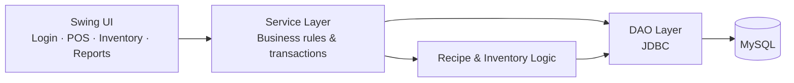

<div align="center">


<p>

<a href="https://github.com/kavikruizz?tab=followers"></a>

</p>

</div>

---

### `root@kavikruizz:~# whoami`

```text
ALIAS       : KaviKruizZ
ROLE        : Software Developer
FOCUS       : Java Desktop | Full-Stack Web | Android
PRINCIPLES  : Clean architecture. Thoughtful UI. Reliable systems.
STATUS      : Learning, building, and refining.
```

I design and develop practical software solutions, from **Java Swing POS and inventory management systems** to **full-stack e-commerce platforms** and **Android applications**. My focus is on clean architecture, reliable data management, and intuitive user experiences that simplify complex business workflows.

### `root@kavikruizz:~# ./load_modules.sh`

```text
[ OK ] desktop  ........ Java · Swing · JDBC
[ OK ] web      ........ HTML · CSS · JavaScript · PHP · Next.js
[ OK ] mobile   ........ Android Studio · Java · SQLite
[ OK ] data     ........ MySQL · MongoDB · Firebase
[ OK ] tooling  ........ Git · GitHub · VS Code · NetBeans · Figma · Docker
```

<div align="center">


</div>

---

### `root@kavikruizz:~# tree projects/`

```text
projects/
├── LedgerOne/     # Restaurant POS & Inventory Management
├── Luxe/          # Fashion E-Commerce Platform
└── RecipeBox/     # Android Recipe Manager
```

<table>
<tr>
<td width="50%" valign="top">

#### `[01] LedgerOne`
**Restaurant POS & Inventory Management**

A Java Swing desktop application for café operations, sales, inventory, and reporting.

```text
+ role-based authentication
+ POS, payment & receipts
+ cancellations & partial refunds
+ recipe-based stock deduction
+ inventory movements & reports
```

<a href="https://github.com/kavikruizz/LedgerOne">
  
</a>


<a href="https://github.com/kavikruizz/LedgerOne">
  <b>⚡ Explore LedgerOne →</b>
</a>

</td>
<td width="50%" valign="top">

#### `[02] Luxe`
**Fashion E-Commerce Platform**

A responsive online shopping experience with customer storefront and admin tools.

```text
+ product browsing & discovery
+ shopping cart & checkout
+ customer account management
+ administration dashboard
+ database-backed operations
```


<a href="https://github.com/kavikruizz?tab=repositories"><b>Explore repositories →</b></a>

</td>
</tr>
</table>

<details>
<summary><b><code>cat ./LedgerOne/architecture.md</code> — view system architecture</b></summary>



```text
sale()   -> record order -> resolve recipe -> deduct ingredients
refund() -> validate paid order -> record refund -> log prepared-food waste
```

**Inventory rule:** Prepared-food refunds do not restore usable ingredient stock. Stock reversals apply only when appropriate, such as qualifying cancellations before preparation.

</details>

---

### `root@kavikruizz:~# cat principles.conf`

```ini
[engineering]
structure_first   = true
user_centred_ui   = true
data_integrity    = true
ship_then_refine  = true

[mindset]
discipline        = constant
curiosity         = unlimited
execution         = deliberate
```

---

### `root@kavikruizz:~# git stats --overview`

<div align="center">


</div>

---

### `root@kavikruizz:~# ./connect.sh`

Open to collaboration, freelance projects, and interesting engineering challenges.

<div align="center">

<a href="mailto:kavikruizz1@gmail.com"></a>
<a href="https://github.com/kavikruizz"></a>
<a href="https://www.linkedin.com/in/kavikruizz"></a>


<br />

### `DECODE. DISRUPT. REWRITE.`

<sub><code>I wasn't coded to obey. I was born to rewrite the system.</code></sub>

<br /><br />


</div>
